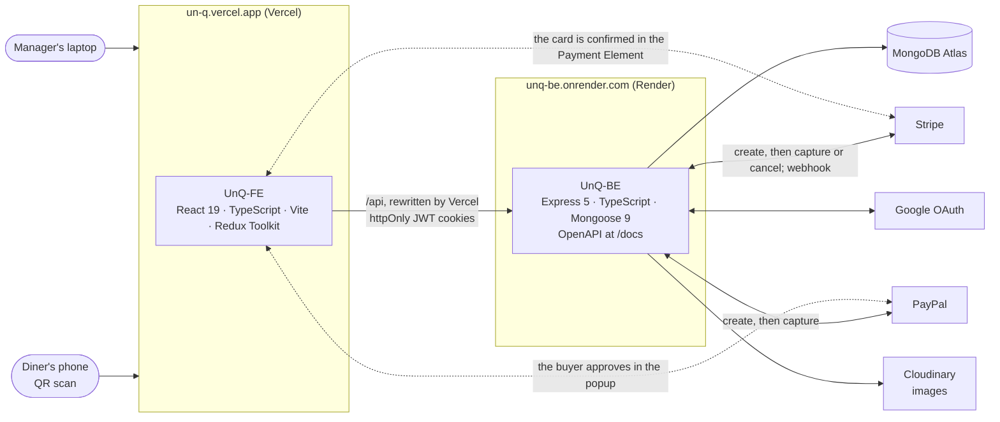

# UnQ

Scan the QR code on your table, order into a cart you share with everyone sitting there, and pay for exactly the items you picked, by card, Apple Pay, Google Pay or PayPal. No app to install, no waiter to wait for. The venue runs its menu, tables and payments from the same site.

[**Live demo**](https://un-q.vercel.app) · [API reference](https://un-q.vercel.app/api/docs) · [UnQ-FE](https://github.com/Nando-C/UnQ-FE), the web client · [UnQ-BE](https://github.com/Nando-C/UnQ-BE), the API

[](https://github.com/Nando-C/UnQ-FE/actions/workflows/ci.yml)
[](https://github.com/Nando-C/UnQ-BE/actions/workflows/ci.yml)
[](./LICENSE)

<p>
  
  
</p>

## Try it

The demo runs at [un-q.vercel.app](https://un-q.vercel.app). Its API sleeps on a free tier, so the first page can take up to a minute to answer; after that it is quick. Payments run in test mode: nothing is charged. The data is rewritten every night: the venues keep ninety days of history ending yesterday, and whatever was ordered at them the day before is gone by morning; an account you create stays.

**As a diner, on your phone.** Scan the code with your camera, or tap it if you are reading this on a phone. It puts you at the Fire Place table of Rocketlit, a demo café. Adding an item asks you to sign in: create an account, sign in with Google, or use `frank@mail.com` with the password `UnqTester1`. Pay by card with Stripe's test card `4242 4242 4242 4242`, any future expiry and any CVC.

<a href="https://un-q.vercel.app/shops/6158a19282eaef10787cd6f3/tables/61702525cc1ec6af70a92f35"></a>

**As the venue, on a laptop.** Sign in as `manager@mail.com` with the password `UnqManager1`. Three venues are yours, with ninety days of payments behind them. Each card shows the venue at a glance: net sales today and over the last seven days against the seven before, the best seller, a highlight, and what its tables need right now. Rocketlit's tables show every state the manager's page can tell: ordering, a selection held too long, a sold-out item in a cart, a payment the provider is still holding, a diner still to be paid back, and a deleted table whose last cart can still be refunded. Each venue's Sales tab reads its payments as a report: the trend against the period before, when it sells, what the menu earns, refunds by cause, and highlights in plain sentences.


More cards to try, and what each screen does, are in the client's [Try it](https://github.com/Nando-C/UnQ-FE#try-it).

## What it does

**For diners.** Scan, see the menu with what is sold out, add to the table's shared cart from any number of phones, pick the units you will pay for, and pay by card, Apple Pay, Google Pay or PayPal. If a payment is interrupted, the table tells you how it ended on your next visit.

**For venues.** Shops, menus with photos, availability and soft deletes; tables with printable QR codes; a page that shows every table's state and what needs a look; a sheet per table to release a stuck selection, remove an item, close or merge carts, refund lines of a payment with a reason, check a payment the provider is holding, and settle what a provider won't return. A sales page per shop over the payments: the period stepped and compared with the one before, a trend of any measure, when the shop sells by weekday and hour, what the menu earns, refunds by cause, new against returning diners, the tables, and highlights in plain sentences; the tables as CSV.

**For the books.** An order per payment, a record per card payment and a pay-back per sum staff must return by hand, each outliving the cart, table and shop it came from.

## What it has to get right

**Nothing is charged until the units are reserved, nobody stays charged for units they didn't get, and the screen never shows a diner something that isn't true.** Several people pay against one cart at the same time, prices change mid-order, items sell out, and a diner can close the tab halfway through a card payment. The API creates every payment from database prices, captures it only after re-checking the cart under optimistic concurrency, finishes an abandoned card payment one finisher at a time by claim and lease, and refunds automatically when a concurrent payer wins the race after capture. The client never prices or captures, is optimistic only where a round trip would feel slow, applies only the latest answer to any question it asked twice, and keeps every outcome on screen until the diner closes it. The two halves of the argument are the API's [payments.md](https://github.com/Nando-C/UnQ-BE/blob/main/docs/payments.md) and the client's [checkout.md](https://github.com/Nando-C/UnQ-FE/blob/main/docs/checkout.md).

## How it is built

Two repositories, one origin for the browser.



| | [UnQ-FE](https://github.com/Nando-C/UnQ-FE) | [UnQ-BE](https://github.com/Nando-C/UnQ-BE) |
|---|---|---|
| What it is | The web client: the diner's menu, cart and checkout; the manager's shops, menus and tables | The API: data model, authentication, the manager's tools and the money |
| Stack | React 19, TypeScript 6, Vite 8, Redux Toolkit, React Router 7, React-Bootstrap, Stripe Payment Element, PayPal | Express 5, TypeScript 6, MongoDB with Mongoose 9, zod, Stripe, PayPal, Google OAuth, Cloudinary |
| Tests | Vitest with Testing Library and msw; a headless-Chrome layout audit from 320px to 1440px and at 200% text; a contract test against the API's OpenAPI document | A Jest integration suite driving the app against an in-memory MongoDB with a fake Stripe that replays the races; an index test that fails if a main route scans a collection |
| Runs on | Vercel | Render, with MongoDB Atlas |
| Docs | [docs/](https://github.com/Nando-C/UnQ-FE/tree/main/docs): architecture, checkout, manager tools, UX decisions, responsive and accessibility, deployment, testing, known gaps | [docs/](https://github.com/Nando-C/UnQ-BE/tree/main/docs): API conventions, data model, payments, auth, operations, decisions, known gaps; the [OpenAPI reference](https://un-q.vercel.app/api/docs) |

The client calls the API on its own origin, which Vercel rewrites to Render, so the session cookies are first-party and Safari keeps them. Sign-in is two httpOnly cookies, a short-lived access token and a rotating refresh token; the client refreshes once on a 401 and replays. At checkout the client asks the API to create the payment, the diner confirms with the provider, and the client asks the API to capture; the API re-checks the cart and only then takes the money. The sequence is drawn in the API's [api.md](https://github.com/Nando-C/UnQ-BE/blob/main/docs/api.md#checkout-at-a-glance).

## Run it yourself

Each repository's README has a quick start; the API first, then the client.

```bash
git clone https://github.com/Nando-C/UnQ-BE.git && cd UnQ-BE && npm install && cp .env.example .env && npm run dev   # :3001
git clone https://github.com/Nando-C/UnQ-FE.git && cd UnQ-FE && npm install && cp .env.example .env && npm run dev   # :3000
```

The API needs a MongoDB and test-mode credentials from Stripe, PayPal, Google and Cloudinary, each linked from [its quick start](https://github.com/Nando-C/UnQ-BE#quick-start); it lists every missing one at boot. `npm run seed:demo` there writes the demo venues, their history and the two sign-ins above. The client's suite and build need nothing else.

## Roadmap

Shipped in 2.3.0: each shop at a glance on My Shops, over the sales report shipped in 2.2.0, and a demo that rewrites its data every night. Next, in order: [staff on a shop, then staff roles](https://github.com/Nando-C/UnQ/issues/3); [kitchen screens with live updates](https://github.com/Nando-C/UnQ/issues/4). Each issue says what the work is on each side. What each app knowingly doesn't do yet, and what it accepts, is on its known-gaps page and in its issues: [the client's](https://github.com/Nando-C/UnQ-FE/blob/main/docs/known-gaps.md) and [the API's](https://github.com/Nando-C/UnQ-BE/blob/main/docs/known-gaps.md).

## About

UnQ began as a five-week solo capstone in 2021 and was rebuilt in 2026: new frameworks on both sides, card payments beside PayPal, the shared-cart selection, the manager's tools, the test suites, the layout audit and the OpenAPI contract. Each repository's changelog has the releases. Released under the [MIT licence](./LICENSE).

[Hernando Crespo](https://hernando-crespo.vercel.app/) · [the client](https://github.com/Nando-C/UnQ-FE) · [the API](https://github.com/Nando-C/UnQ-BE) · [the live demo](https://un-q.vercel.app)
